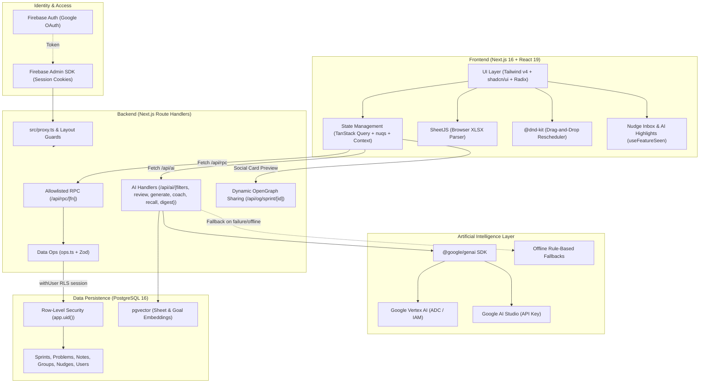

# Sprintboard — Project Overview

Sprintboard is a full-stack, AI-augmented Data Structures and Algorithms (DSA) preparation tracker. It converts `.xlsx` problem sheets into structured, day-by-day study sprints, supports public catalog sharing, group collaboration, and integrates Gemini models for natural-language filtering, automated note code review, goal-driven sprint generation, smart rescheduling, and weekly team activity digests.

---

## 1. System Architecture Diagram



---

## 2. Technology Stack Breakdown

### Frontend Core & UI
| Technology | Version / Spec | Purpose & Usage |
| :--- | :--- | :--- |
| **Next.js** | `16.3.8` | App Router, React Server Components (RSC), Turbopack build engine, and server actions/proxy architecture. |
| **React** | `19.2.8` | Modern UI rendering library utilizing latest React 19 primitives. |
| **TypeScript** | `^5.0` | Strict static type safety across client, server, and database operations. |
| **Tailwind CSS** | `^4.0` | Utility-first CSS styling using `@tailwindcss/postcss`. |
| **shadcn/ui & Radix UI** | `^1.6` | Accessible UI primitives (dialogs, drawers, dropdowns, tooltips, tabs, popovers). |
| **Motion** | `^13.4` | Smooth micro-animations, drawer interactions, and layout transitions. |
| **Lucide React** | `^1.49` | Consistent icon set across navigation, actions, and status indicators. |
| **Sonner** | `^2.0` | Toast notification manager for optimistic UI actions and confirmations. |
| **Next Themes** | `^0.4` | Dark/light theme support with zero flash on initial load. |
| **cmdk** | `^1.1` | Keyboard-driven command palette (`⌘K`) with AI quick-launch actions. |

### Client State, Data Fetching & Interactivity
| Library | Version | Purpose |
| :--- | :--- | :--- |
| **TanStack React Query** | `^5.104` | Async server state management, caching (`staleTime: 30s`), and optimistic rollbacks (`useSprint`). |
| **TanStack React Virtual** | `^3.14` | High-performance virtualized rendering for large problem sets. |
| **nuqs** | `^2.10` | Type-safe URL search parameter synchronization for filter state. |
| **@dnd-kit/core** | `^6.3` | Drag-and-drop scheduling of problems between sprint days. |
| **SheetJS (`xlsx`)** | `0.20.3` | Client-side Excel parsing with auto-detection of column mapping and embedded hyperlinks. |
| **Recharts** | `^3.8` | Interactive analytics charts (streaks, 26-week activity heatmap, difficulty breakdowns). |
| **React Markdown + Rehype / Remark** | `react-markdown v10`, `rehype-highlight v7`, `remark-gfm v4` | Markdown problem note rendering with code block syntax highlighting. |

### Backend, APIs & Dynamic Media
| Component | Implementation | Description |
| :--- | :--- | :--- |
| **Next.js Route Handlers** | Node.js Runtime (`export const runtime = "nodejs"`) | Handles server-side RPC, AI endpoints, and dynamic social image generation. |
| **Allowlisted RPC Pattern** | `POST /api/rpc/[fn]` | Typed, parameter-validated procedures dispatched to `src/lib/db/ops.ts`. Prevents ad-hoc or vulnerable queries. |
| **Dynamic OpenGraph Images** | `next/og` (`ImageResponse`) | Edge-compatible SVG/PNG rendering at `/api/og/sprint/[id]` for social preview cards (Twitter/LinkedIn) displaying streak, progress, and difficulty stats. |
| **Validation** | **Zod v4** (`^4.6.5`) | Schema definition and runtime validation for RPC inputs, AI payloads, and environment variables. |
| **Auth Gateway** | `src/proxy.ts` + `getSessionUser()` | Lightweight cookie check at edge, backed by Firebase Admin SDK session verification in layouts and route handlers. |

### Authentication & Authorization
| Service | Integration | Description |
| :--- | :--- | :--- |
| **Firebase Auth** | `firebase v13` (Client) | Google OAuth single sign-on (SSO). |
| **Firebase Admin SDK** | `firebase-admin v14` (Server) | Verifies session cookies on authenticated requests; extracts Firebase `uid`. |
| **Firebase Auth Emulator** | Port `:9099` | Local authentication testing without requiring cloud credentials. |

### Database & Persistence
| Component | Details | Role |
| :--- | :--- | :--- |
| **PostgreSQL** | PostgreSQL 16+ | Relational data store for users, sprints, problems, notes, groups, and nudges. |
| **Driver & Connection** | `pg` (`node-postgres`) + `@google-cloud/cloud-sql-connector` | Connection pooling (`src/lib/db/pool.ts`) with Cloud SQL IAM authentication in production. |
| **Row-Level Security (RLS)** | `withUser(uid, fn)` | Every user query runs in a localized transaction with `SET LOCAL app.uid = $uid; SET LOCAL ROLE authenticated;`. Data isolation is enforced at the database engine level. |
| **pgvector** | PostgreSQL extension | Vector storage and cosine similarity queries for sheet catalog search and user study goals. |
| **Database Migrations** | `scripts/migrate.mjs` + `db/migrations/*.sql` | Ordered, idempotent SQL migration runner managing schema, security-definer functions, and RLS policies. |

---

## 3. Artificial Intelligence Architecture & Models

Sprintboard integrates Google Gemini through the `@google/genai` SDK (`^2.30.0`), running either on **Google Vertex AI** (via Application Default Credentials in production) or **Google AI Studio** (via `GEMINI_API_KEY`).

### AI Models & Workflows

| Capability | Model | Endpoint | Description |
| :--- | :--- | :--- | :--- |
| **Goal-Driven Sprint Generation** | `gemini-2.5-flash-lite` | `/api/ai/generate` | Analyzes goals (e.g., *"Google SDE-2 in 6 weeks, weak at DP and trees, 2 hrs/day"*). Selects and orders existing catalog problems from public sheets, guaranteeing valid links without hallucinations. |
| **Solution Note Review** | `gemini-2.5-flash-lite` | `/api/ai/review` | Evaluates user notes: calculates asymptotic time/space complexity, identifies missed edge cases, and tags algorithmic patterns. |
| **Natural Language Filters** | `gemini-2.5-flash-lite` | `/api/ai/filters` | Translates natural language queries (e.g., *"easy arrays asked at Meta"*) into structured filter objects with topic synonyms and company aliases. |
| **Active Recall & Viva** | `gemini-2.5-flash-lite` | `/api/ai/recall` | Generates spaced-repetition warm-up questions and oral mock interview prompts based on problems solved in previous days. |
| **Weekly Group Digest** | `gemini-2.5-flash-lite` | `/api/ai/digest` | Rewords precomputed group study facts into an engaging, motivational weekly team summary with member shoutouts and peer nudge ideas. |
| **Smart Reschedule Coach** | `gemini-2.5-flash` | `/api/ai/coach` | Evaluates overdue problems, study velocity, and upcoming days to recommend optimal rescheduling plans (compress, slide, or distribute backlog). |
| **Semantic Vector Search** | `gemini-embedding-001` (768 dimensions) | `scripts/embed-sheets.mjs` & `/api/ai/recall` | Embeds public sheet documents and user study goals into `pgvector` for similarity search and recommendations. |

### Reliability & Fault Tolerance
1. **Strict JSON Schema Enforcement**: Gemini calls utilize `responseMimeType: "application/json"` and `responseJsonSchema` compiled via Zod, guaranteeing predictable and type-safe model outputs.
2. **Offline Rule-Based Heuristics**: If AI is disabled (`AI_ENABLED=false`) or encounters an API error/timeout, the system degrades gracefully to built-in offline engines:
   - *Review*: Rule-based regex complexity analysis and edge case checklist (`src/lib/review/heuristics.ts`).
   - *Generate*: Deterministic problem selector matching topics and difficulty tags (`src/lib/generate/heuristic.ts`).
   - *Coach*: Mathematical schedule shifter based on overdue problem ratios (`src/lib/coach/planner.ts`).
   - *Digest*: Structured templated report based on precomputed member facts (`src/lib/digest/template.ts`).
3. **Rate Limiting & In-Memory LRU Caching**: Token-bucket limiters prevent abuse (`src/lib/ai/limits.ts`), while deterministic hashing of request bodies caches repeated queries to save compute and cost.

---

## 4. Key Application Features

- **XLSX Sheet Ingestion**: Drag-and-drop any Excel DSA sheet; auto-detects columns (`Name`, `URL`, `Difficulty`, `Topic`, `Company`, `Sprint`, `Day`) with manual mapping adjustments.
- **Sprint Management & Rescheduling**:
  - Drag problems between days.
  - Skip weekends and insert custom rest days.
  - **Shift Backlog**: Instantly moves overdue items to today while preserving relative scheduling.
  - **AI Coach Dialog**: Side-by-side proposed schedule diff with intelligent rationale before applying changes.
- **Daily Warmup & Spaced Repetition**:
  - Daily active recall questions on solved problems.
  - Viva mock interview mode testing conceptual problem-solving depth.
- **Collaborative Study Groups**:
  - Share invite links; group members maintain their own sheet copy while tracking collective problem progress, leaderboards, and completion matrices.
  - **Weekly AI Digest**: Automated weekly performance summary highlighting MVPs, solve momentum, and study recommendations.
  - **Peer Nudges & Nudge Inbox**: Send polite peer nudges with optional 140-char custom messages (e.g., *"Pair up on LRU Cache tonight?"*), protected by daily rate limits and managed via an in-app inbox drawer.
- **Markdown Notes Drawer**: Autosaving solution editor supporting code blocks, syntax highlighting, and one-click AI note analysis.
- **Public Sheets & Catalog Sharing**: Publish sprints to the Explore catalog (`/app/explore`) where other users can clone problem sets into personal private sprints.
- **Social Progress Sharing & Dynamic Cards**:
  - Instant modal to generate dynamic OpenGraph preview cards showcasing streak, problems solved, and difficulty breakdown.
  - One-click share actions for Twitter / X and LinkedIn.
- **AI Feature Highlights & Discovery**:
  - `AiBadge` visual indicators with glowing pulse styling on AI-powered actions.
  - First-time feature discovery tracking (`useFeatureSeen`) highlighting new capabilities across the UI.
- **Keyboard Navigation**: Power-user shortcuts palette (`⌘K`), quick navigation (`j`/`k`), status toggle (`x`), star toggle (`s`), and notes toggle (`n`).

---

## 5. Testing & Quality Assurance

| Test Suite | Command | Coverage & Scope |
| :--- | :--- | :--- |
| **Unit & Component Tests** | `npm test` | Vitest with `jsdom`, testing React components, reducers, and scheduling algorithms. |
| **Database Integration** | `npm run test:db` | Tests PostgreSQL schema, security-definer functions, and Row-Level Security isolation across multiple user roles. |
| **Live AI Evaluation** | `npm run test:ai` | Automated live prompt evals (*.eval.ts) against Gemini APIs testing schema compliance and model accuracy. |
| **Type Checking** | `npm run typecheck` | Strict `tsc --noEmit` validation across entire codebase. |
| **Linting** | `npm run lint` | ESLint 9 checking for Next.js conventions and React 19 best practices. |

---

## 6. Directory Layout Reference

```
sprint-tracker-1/
├── db/
│   └── migrations/         # Timestamped SQL migrations (RLS, schema, pgvector, nudge_messages)
├── scripts/
│   ├── migrate.mjs         # Migration executor
│   └── embed-sheets.mjs    # Batch vector embedding utility
├── src/
│   ├── app/
│   │   ├── api/
│   │   │   ├── ai/         # AI Route Handlers (coach, digest, filters, generate, recall, review)
│   │   │   ├── og/         # Dynamic OpenGraph image generation route for social sharing
│   │   │   ├── rpc/        # Allowlisted RPC endpoint dispatcher
│   │   │   ├── me/         # Profile, accent color, and study goal management
│   │   │   └── share/      # Public sheet sharing routes
│   │   ├── app/            # Authenticated application views (sprint, explore, import, stats)
│   │   ├── auth/           # Firebase session callback and logout endpoints
│   │   ├── layout.tsx      # Root layout with theme, query, and font providers
│   │   └── proxy.ts        # Fast session-cookie presence router
│   ├── components/
│   │   ├── groups/         # Study group views, leaderboards, weekly digest, nudge composer
│   │   ├── sprint/         # Sprint timeline, coach dialog, daily recall, notes drawer
│   │   ├── shell/          # Navigation, nudge inbox drawer, user menus
│   │   ├── stats/          # Heatmaps, streak counters, share report modal
│   │   ├── import/         # Spreadsheet parser & goal-based sprint generator
│   │   └── ui/             # Radix & shadcn UI primitives, AI badges
│   ├── hooks/              # Custom hooks (useSprint, useCoach, useGroups, useFilters, useFeatureSeen)
│   └── lib/
│       ├── ai/             # Gemini client, coach prompts, embeddings, limits
│       ├── coach/          # Backlog signals, diff calculations, reschedule planners
│       ├── digest/         # Group facts extractor, weekly digest prompt & fallback template
│       ├── recall/         # Active recall & viva question schemas and generators
│       ├── review/         # Note review analysis engines (AI + heuristics)
│       ├── generate/       # Goal-based sprint roadmap generator
│       ├── db/             # pg connection pool, RLS session wrapper (withUser), allowlisted ops
│       ├── firebase/       # Firebase Client & Admin SDK initializers
│       ├── xlsx/           # SheetJS workbook parser & column mapper
│       └── types.ts        # Domain TypeScript definitions
├── apphosting.yaml         # Firebase App Hosting deployment configuration
├── docker-compose.yml      # Local PostgreSQL container specification
└── package.json            # Project manifest & dependency declarations
```
